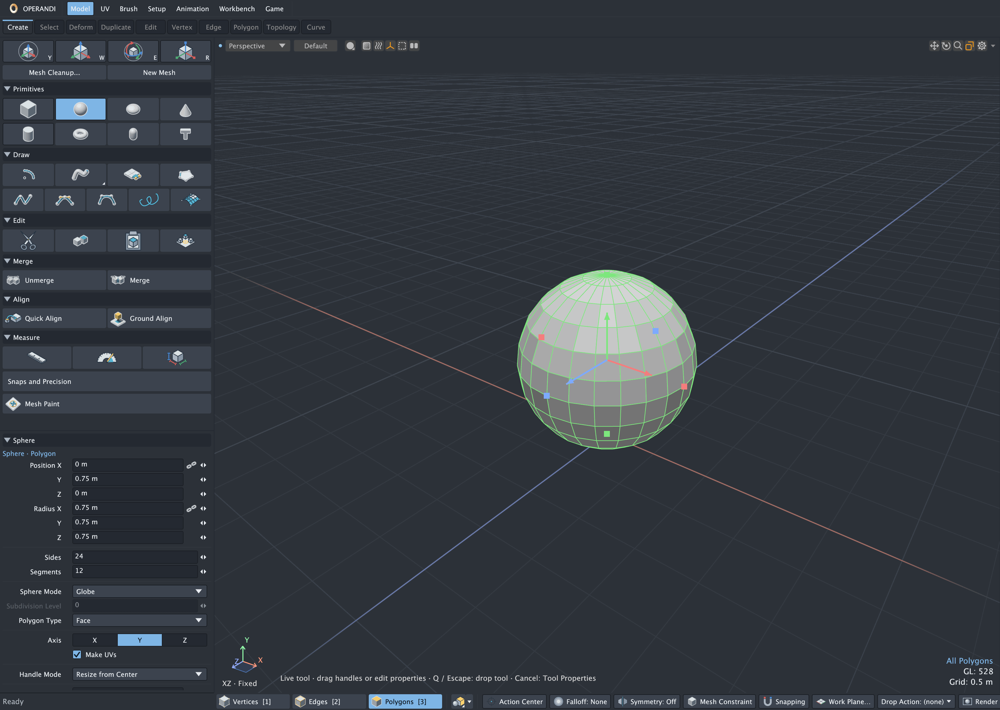

<!-- help-ids: Sphere, prim.sphere, Sphere Unit, Sphere New Unit ; template: tool ; since: 0.1.0 -->
# Sphere

**Sphere** adds a ball: rings of polygons around an axis, closed at both poles, or an evenly split ball.

## How to use

1. Make sure the mesh you want to add to is selected in the **Items list**.
2. Click **Sphere** in the **Primitives** section of the **Create** tool tab.
3. Drag in the **3D view**. The drag draws the sphere's base flat on the
   **Work Plane**, from where you press to where you let go.
4. Drag a side handle to give the flat draft its depth, or type its **Radius**.
5. Fine-tune it: drag its handles, or type values in **Tool Properties**.
6. Press **Q** (or **Esc**), or click **Sphere** again, to drop the tool
   and keep the sphere.

To draw it the same size in every direction instead, hold **Control** before
you start the drag: the press is the centre and the pointer sets the
size.

## Without a drag

- **Shift**-click **Sphere** adds a 1 m sphere as a new mesh item at
  the scene's origin.
- **Control**-click **Sphere** adds a 1 m sphere to the selected mesh, at
  its origin.

## Handles

| Handle | Drag it to |
|---|---|
| Square on a side | Change the **Radius** along that axis; hold **Control** to move the sphere instead |
| Arrows in the middle | Move the sphere |

## Properties

| Name | What it does | Default |
|---|---|---|
| **Position** | Where the sphere's centre is (X, Y, Z). | 0 m |
| **Radius** | Half the sphere's size along X, Y and Z. Different values make an egg shape. | 0.5 m |
| **Sides** | How many polygons go round the axis. | 24 |
| **Segments** | How many rings of polygons go from pole to pole. | 12 |
| **Sphere Mode** | **Globe**: rings round an axis. **Tessellated**: an evenly split ball. (**Quad Ball** isn't available yet.) | Globe |
| **Subdivision Level** | How often a **Tessellated** sphere is split, 0 to 6. | 0 |
| **Polygon Type** | The kind of polygons made. | Face |
| **Axis** | The axis the poles sit on. | Y |
| **Make UVs** | Gives the shape a UV layout in the **Texture** UV map, for textures. | On |
| **Handle Mode** | Side handles resize from the centre. | Resize from Center |
| **Min**, **Max** | The sphere's lowest and highest corner. | from Position and Radius |

Rows in grey aren't available yet; they show their value only. They are **Distortion Compensation**, **Gaps** and **Show Corner**.

- **Reset Tool Attributes** puts **Sides** and **Segments** back to their
  starting values; later uses start from them too.
- **Drop Tool** keeps the sphere and closes the tool. **Cancel** takes
  back the last change.

## Tips

- To get a round ball, keep the three **Radius** values equal: hold
  **Control** while you draw, or type one value and press **Tab** to the
  next.

## Related

- [Primitives](../interface/window.md): the **Toolbox** on the **Create** tab
- [Interface](../interface/window.md): the **Work Plane** and **Tool Properties**
- [Ellipsoid](ellipsoid.md), [Capsule](capsule.md)
