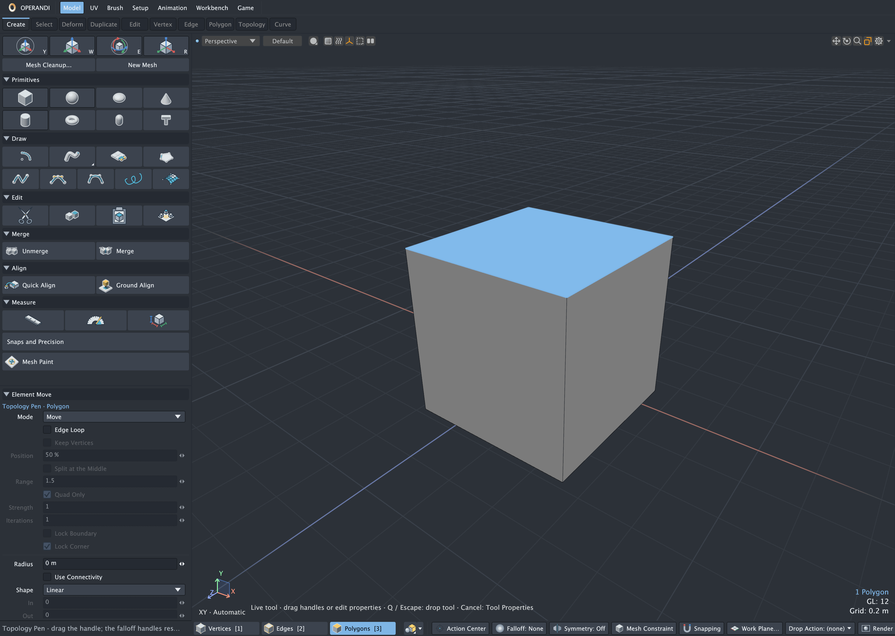

<!-- help-ids: Topology Pen, mesh.topology ; template: tool ; since: 0.1.0 -->
# Topology Pen

**Topology Pen** reshapes the polygons of a mesh directly: move, copy, remove, split and fill them with one drag, usually while you build a clean new mesh over a background model.

## How to use

1. Make sure the mesh you want to work on is selected in the **Items list**.
2. Click **Topology Pen** in the **Draw** section of the **Create** tool tab.
3. Choose what a plain drag does in **Mode**.
4. Drag a point, edge or polygon in the **3D view**. Each drag is one undo
   step.
5. Press **Q**, or click **Drop**, to keep it and close the tool.

The modifier keys work whatever the **Mode**:

| Do this | To |
|---|---|
| Left-drag | Use the **Mode** |
| Right-drag an edge | Move its whole loop |
| Right-drag empty space | Set **Radius** |
| Middle-drag | Split |
| **Shift**+drag | Duplicate (pull a new strip out of an edge) |
| **Control**+drag | Slide points along their edges, or make a new quad in empty space |
| **Shift**+**Control**+drag | Smooth |

**Topology Pen** on the **Topology** tool tab starts the same tool with the
background constraint on and snapping off, ready for drawing over a
background model. They go back as they were when you drop it.

## Properties

| Name | What it does | Default |
|---|---|---|
| **Mode** | What a plain left-drag does: **Move**, **Duplicate**, **Remove**, **Split**, **Add Loop**, **Point**, **Fill** or **Smoothing**. | Move |
| **Edge Loop** | Edges act on their whole loop (Move, Duplicate, Remove, Smoothing). | Off |
| **Keep Vertices** | **Remove** keeps points a removed edge leaves in only two edges. | Off |
| **Position** | **Add Loop**: where the last loop went across its ring. | 50 % |
| **Split at the Middle** | **Add Loop** always cuts at 50 %. | Off |
| **Range** | **Fill**: how far to look for points, in average edge lengths. | 1.5 |
| **Quad Only** | **Fill** makes only quads; off, a triangle where no quad fits. | On |
| **Strength**, **Iterations** | How strongly and how often **Smoothing** relaxes the points. | 1, 1 |
| **Lock Boundary**, **Lock Corner** | Keep open edges, or corner points, still while smoothing. | Off, On |
| **Radius** | How far a drag reaches round the element. 0 moves just the element. | 0 m |
| **Use Connectivity** | Only points connected to the element move. | Off |
| **Shape**, **In**, **Out** | How the effect fades from the element out to **Radius**. | Linear, 0, 0 |
| **Show Vertex**, **Show Edge** | Highlight the point or edge under the pointer before you drag. | On |
| **Inner Snap** | Points inside the mesh snap and weld too, not only border to border. | Off |
| **Copy Discontinuous UVs** | After a weld, the dragged point's UVs win over the target's. | Off |
| **Offset** | An offset (X, Y, Z) for the geometry the pen makes. | 0 m |
| **Edge Slide** | **Move** slides points along their edges, as **Control**+drag does. | Off |

Only the rows the chosen **Mode** uses are lit; the others are greyed.

## Related

- [Interface](../interface/window.md): the **Toolbox** and **Tool Properties**
- [Pen](pen.md)
