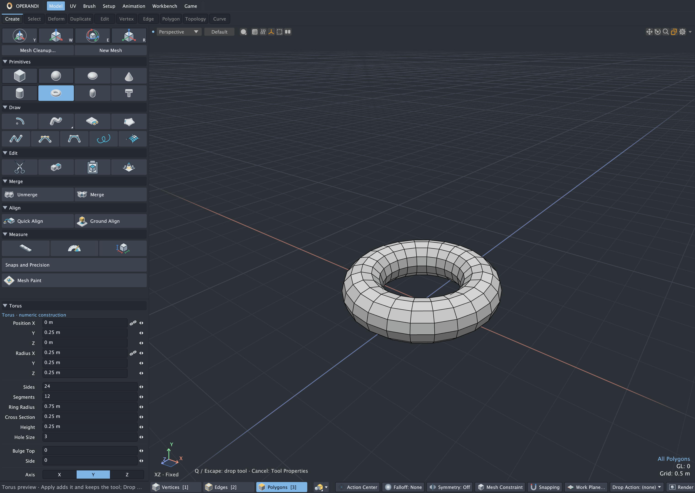

<!-- help-ids: Torus, prim.torus, prim.toroid, Torus Unit, Torus New Unit ; template: tool ; since: 0.1.0 -->
# Torus

**Torus** adds a ring, like a doughnut: a round cross-section swept round an axis.

## How to use

1. Make sure the mesh you want to add to is selected in the **Items list**.
2. Click **Torus** in the **Primitives** section of the **Create** tool tab.
3. Drag in the **3D view**. The drag draws the torus's base flat on the
   **Work Plane**, centred on where you press.
4. Press on the dot in the middle of the flat base and drag up to give it its height.
5. Fine-tune it: drag its handles, or type values in **Tool Properties**.
6. Press **Q** (or **Esc**), or click **Torus** again, to drop the tool
   and keep the torus.

To draw it the same size in every direction instead, hold **Control** before
you start the drag: the press is the centre and the pointer sets the
size.

## Without a drag

- **Shift**-click **Torus** adds a 1 m torus as a new mesh item at
  the scene's origin.
- **Control**-click **Torus** adds a 1 m torus to the selected mesh, at
  its origin.

## Properties

| Name | What it does | Default |
|---|---|---|
| **Position** | Where the centre is (X, Y, Z). | 0 m |
| **Radius** | The ring's overall half-size along X, Y and Z. | 0.25 m |
| **Sides** | How many steps go round the ring. | 24 |
| **Segments** | How many steps go round the cross-section. | 12 |
| **Ring Radius** | Distance from the centre to the middle of the cross-section. | 0.5 m |
| **Cross Section** | Half the cross-section's width. | 0.25 m |
| **Height** | Half the cross-section's height. | 0.25 m |
| **Hole Size** | **Ring Radius** divided by **Cross Section**. Change it to open or close the hole; **Ring Radius** follows. | 2 |
| **Bulge Top**, **Side** | Push the cross-section toward a square. | 0 |
| **Axis** | The axis the ring goes round. | Y |
| **Make UVs** | Gives the shape a UV layout in the **Texture** UV map, for textures. | On |

- **Apply** adds the torus to the mesh and keeps the tool, so you can
  make another.
- **Drop** adds it and closes the tool.
- **Cancel** throws the preview away.
- **Reset** puts every value back to its starting value.

## Tips

- **Radius**, **Ring Radius**, **Cross Section**, **Height** and **Hole
  Size** are linked: change one and the others that depend on it follow.
  A **Hole Size** of 1 closes the hole to the axis.

## In the Mesh Stack

You can also add a Torus as a step of a mesh's **Mesh Stack**: choose
**Torus** under **Create > Primitives** in the stack's **Add Operator**
list. It has the same properties as the tool, and the tool and the stack
step build exactly the same torus from the same values, so you can
change it later without rebuilding the mesh. **Hole Size** isn't there:
it follows from **Ring Radius** and **Cross Section**, which are. Scripts
add it with `meshop.create type:prim.toroid.item`.

## Related

- [Primitives](../interface/window.md): the **Toolbox** on the **Create** tab
- [Interface](../interface/window.md): the **Work Plane** and **Tool Properties**
- [Capsule](capsule.md)
