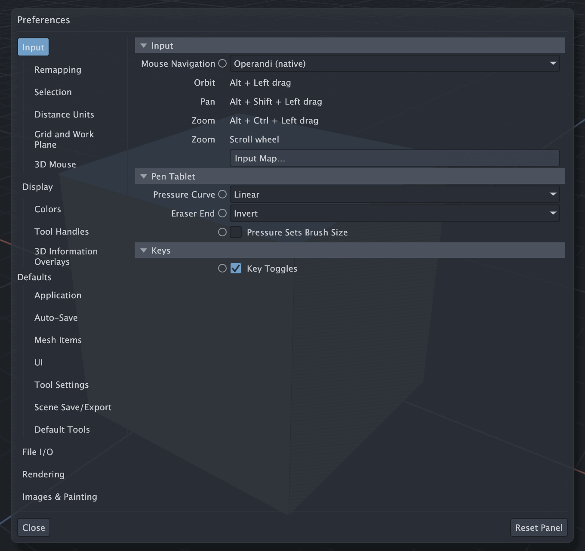

<!-- help-ids: Preferences ; template: panel ; since: 0.1.0 -->
# Preferences

**Preferences** (**Edit > Preferences…**, **Ctrl+,**) holds the settings
that are yours rather than the scene's: they apply to every scene and are
kept between sessions.

## Pages

| Group | Pages |
|---|---|
| **Input** | **Remapping**, **Selection**, **Distance Units**, **Grid and Work Plane**, **3D Mouse** |
| **Display** | **Colors**, **Tool Handles**, **3D Information Overlays** |
| **Defaults** | **Application**, **Auto-Save**, **Mesh Items**, **UI**, **Tool Settings**, **Scene Save/Export**, **Default Tools** |
| Others | **File I/O**, **Rendering**, **Images & Painting** |

The **Input** page sets **Mouse Navigation** (which mouse gestures orbit,
pan and zoom; the rows under it show the current ones), opens the **Input
Map...** to change keys, and sets up a pen tablet.

## Common tasks

- **Change a setting**: pick a page on the left and change the row. It
  applies at once.
- **Put a page back**: **Reset Panel** at the bottom resets the current
  page; **Edit > Reset Preferences…** resets all of them.
- **Close**: **Close**, or **Esc**.

The dot before a row marks a setting saved with your preferences.

## Related

- [Keyboard shortcuts](../reference/keyboard-shortcuts.md)
- [Getting started](../getting-started.md): navigation presets
