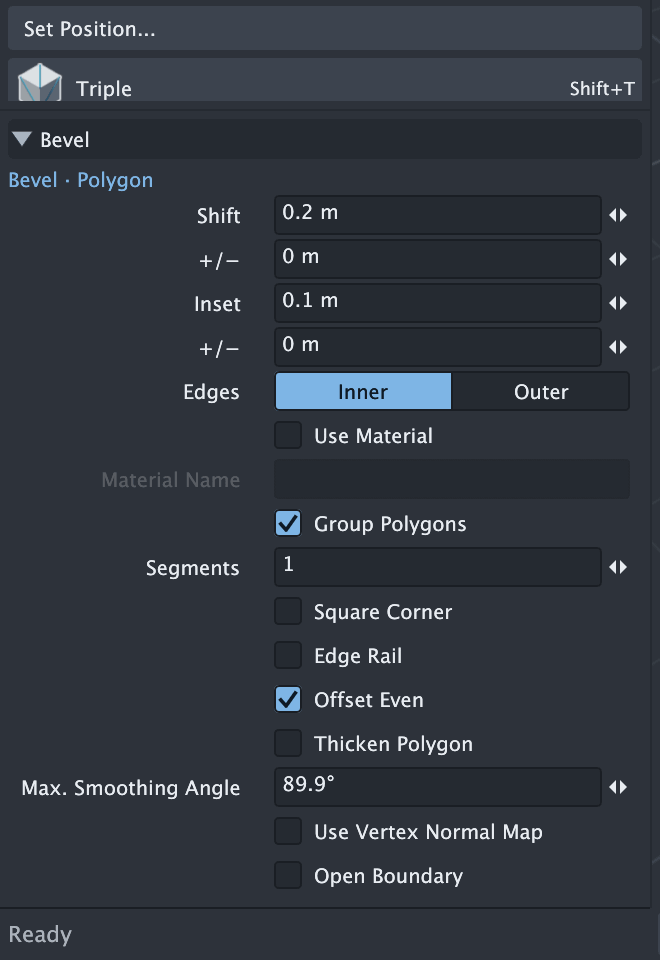

<!-- help-ids: Tool Properties ; template: panel ; since: 0.1.0 -->
# Tool Properties

**Tool Properties** shows the active tool's settings, under the toolbox
on the left. Every tool page in this guide lists its rows.

## What it shows

- The tool's name, with the selection mode it works in (**Bevel ·
  Polygon**).
- Its settings. Typing a value updates the tool's result as you type.
  Fields take expressions, such as `250 mm` or `1 m/4`.
- Sections for the falloff and other layers the tool uses, when it has
  them.
- Its buttons: **Apply** (run once with these values), **Drop Tool** (keep
  the result and close the tool), **Cancel** (take the result back) and,
  where the tool has one, **Reset**.
- Notes under the rows on how to use the tool.

Rows in grey aren't available right now; rest the pointer on one to see
why. With no tool active, the panel says so, and **Apply Last ...** runs
the last tool again with its last values.

**Ctrl+D** (**Reset Tool Attributes**) puts the active tool's settings back
to their starting values.

## Related

- [Interface](../interface/window.md): part 13 is Tool Properties
- [Bevel (polygons)](../modeling/polygon-bevel.md)
