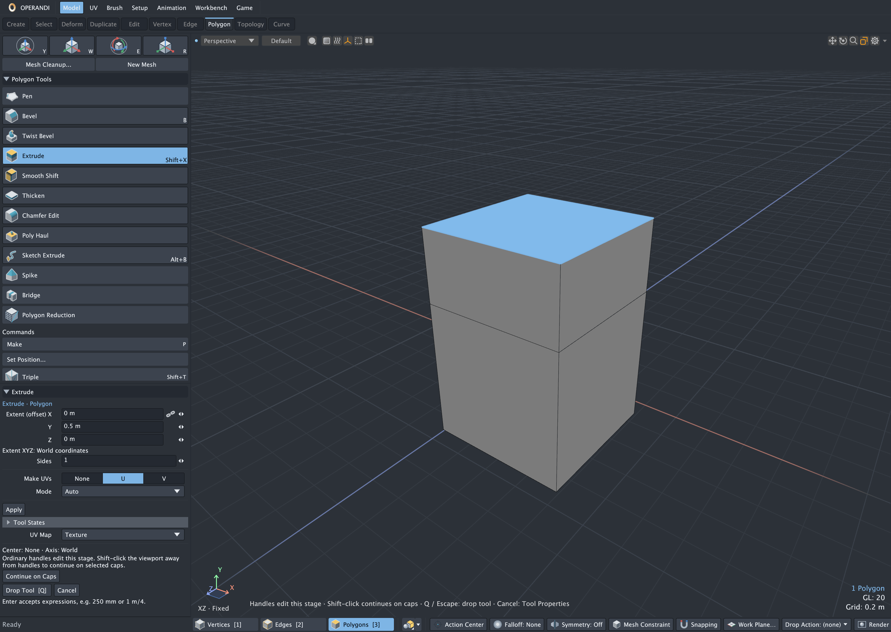

<!-- help-ids: Extrude ; template: tool ; since: 0.1.0 -->
# Extrude

**Extrude** pushes the selected polygons out along a direction and joins them to the mesh with new side polygons.

## How to use

1. Press **3** for Polygons and select the polygons.
2. Press **Shift+X**, or click **Extrude**.
3. Drag the handles, or type **Extent** and click **Apply**.
4. **Shift**-click in the view away from the handles to extrude again from
   the new caps (**Continue on Caps**).
5. Press **Q**, or click **Drop Tool**, to keep the result. **Cancel** takes it back.

## Properties

| Name | What it does |
|---|---|
| **Extent (offset)** | How far the polygons move, along world X, Y and Z. |
| **Sides** | How many rows of side polygons. |
| **Make UVs** | Lays UVs on the sides: **None**, **U** or **V**. |
| **Mode** | **Auto**, **Thick** or **Shift**. |
| **UV Map** | Which UV map gets the side UVs. |

## Related

- [Polygon tab](index.md)
- [Selection modes](../selection/selection-modes.md)
- [Smooth Shift and Thicken](smooth-shift.md)
