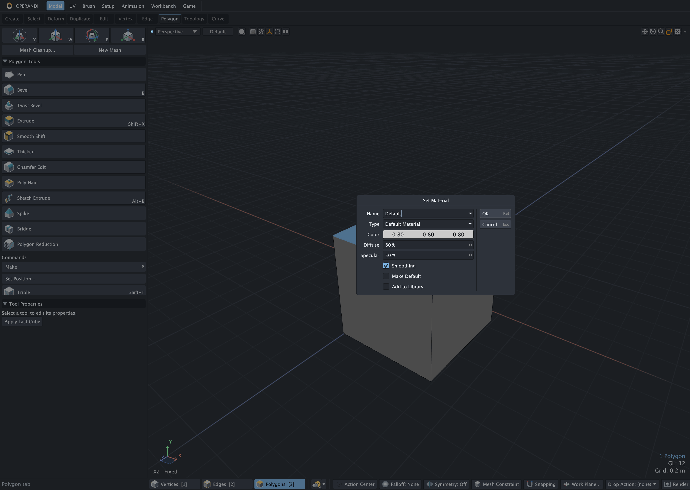

<!-- help-ids: Set Part, Set Material, poly.setMaterial ; template: tool ; since: 0.1.0 -->
# Set Part and Set Material

Give the selected polygons a part name, or a material.

## How to use

1. Select polygons, or none to set the whole mesh.
2. Press **M** (**Set Material...**) or click **Set Part...**.
3. Type a name, or pick an existing one, and click **OK**.

**Set Material** makes a new material when the name is new, with its
**Type**, **Color**, **Diffuse** and **Specular**; **Smoothing** sets its
smoothing; **Make Default** uses it for new polygons; **Add to Library**
saves it for other scenes.

## Related

- [Polygon tab](index.md)
- [Selection modes](../selection/selection-modes.md)
- [Selection modes](../selection/selection-modes.md): Materials mode selects by tag
