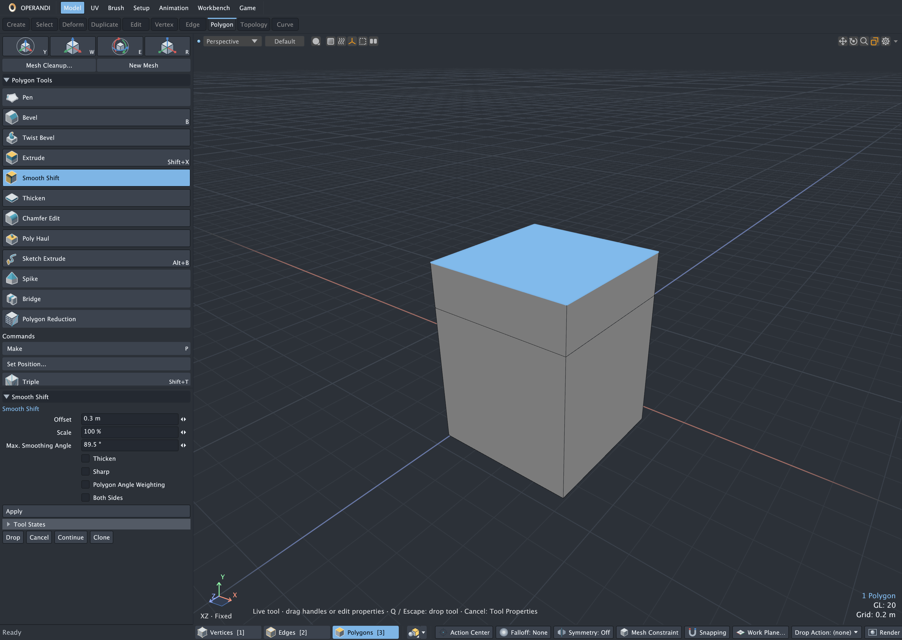
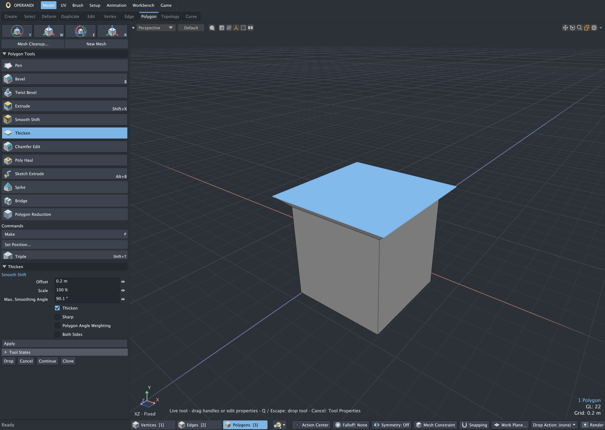

<!-- help-ids: Smooth Shift, poly.smshift, Thicken ; template: tool ; since: 0.1.0 -->
# Smooth Shift and Thicken

**Smooth Shift** moves the selected polygons out along their normals as one smooth shell, with new polygons round the edge. **Thicken** gives a surface thickness: it makes a second, offset copy and joins the two.

## How to use

1. Press **3** for Polygons and select the polygons.
2. Click **Smooth Shift** or **Thicken** on the **Polygon** tool tab.
3. Drag in the view, or type **Offset** and click **Apply**.
4. **Continue** starts a new stage from the result; **Clone** keeps a copy.
5. Press **Q**, or click **Drop Tool**, to keep the result. **Cancel** takes it back.

## Properties

| Name | What it does |
|---|---|
| **Offset** | How far the polygons move along their normals. |
| **Scale** | Scales the moved polygons. |
| **Max. Smoothing Angle** | Edges sharper than this keep their corners. |
| **Thicken** | Keeps the original polygons too, as **Thicken** does. |
| **Sharp** | Keeps sharp corners sharp. |
| **Polygon Angle Weighting** | Weights each normal by its polygons' angles. |
| **Both Sides** | Thickens both ways from the surface. |

## Related

- [Polygon tab](index.md)
- [Selection modes](../selection/selection-modes.md)
- [Extrude](extrude.md)
