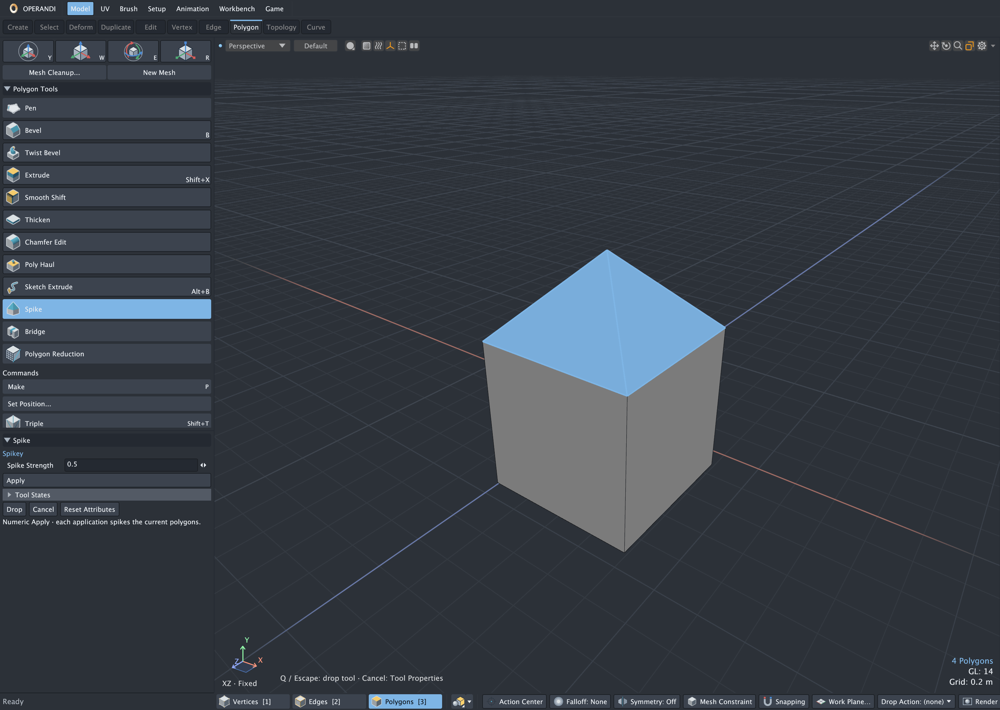

<!-- help-ids: Spike, poly.spikey ; template: tool ; since: 0.1.0 -->
# Spike

**Spike** raises a point in the middle of each selected polygon, turning it into a pyramid of triangles.

## How to use

1. Press **3** for Polygons and select the polygons.
2. Click **Spike** on the **Polygon** tool tab.
3. Type **Spike Strength** and click **Apply**. Each **Apply** spikes the
   current polygons again.
4. Click **Drop** to keep the result.

## Properties

| Name | What it does |
|---|---|
| **Spike Strength** | How far the new point rises. |

## Related

- [Polygon tab](index.md)
- [Selection modes](../selection/selection-modes.md)
