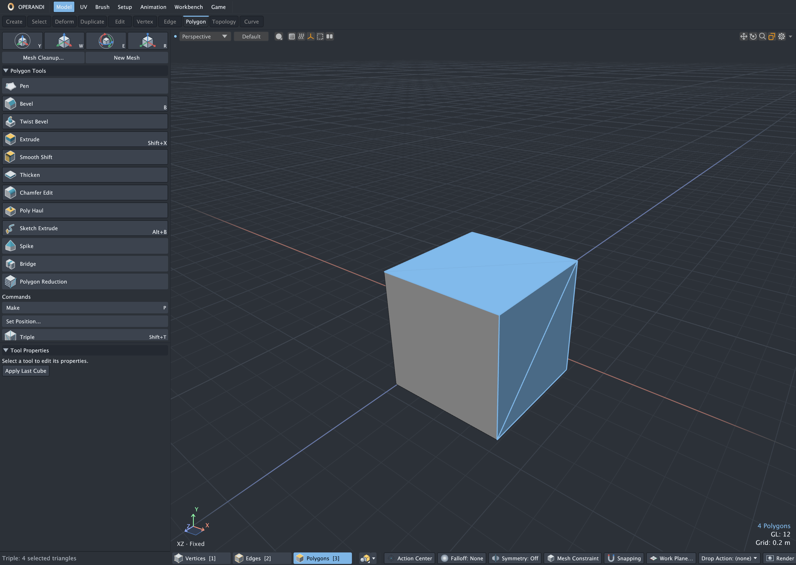

<!-- help-ids: Triple, poly.triple, Triple Fan, Quadruple, poly.quadruple, Detriangulate, Spin Quad, poly.spinQuads ; template: tool ; since: 0.1.0 -->
# Triangles and quads

Commands that split polygons into triangles, or join them back into quads.

## The commands

| Button | Key | What it does |
|---|---|---|
| **Triple** | **Shift+T** | Splits the selected polygons into triangles. |
| **Triple Fan** |  | Splits the selected polygons into triangles that all meet at the selected point. |
| **Quadruple** |  | Turns a two-row polygon into a row of quads. |
| **Detriangulate...** |  | Joins pairs of triangles back into quads. |
| **Spin Quad** | **Alt+V** | Turns the shared edge of two selected polygons to their next corners. |

## Related

- [Polygon tab](index.md)
- [Selection modes](../selection/selection-modes.md)
