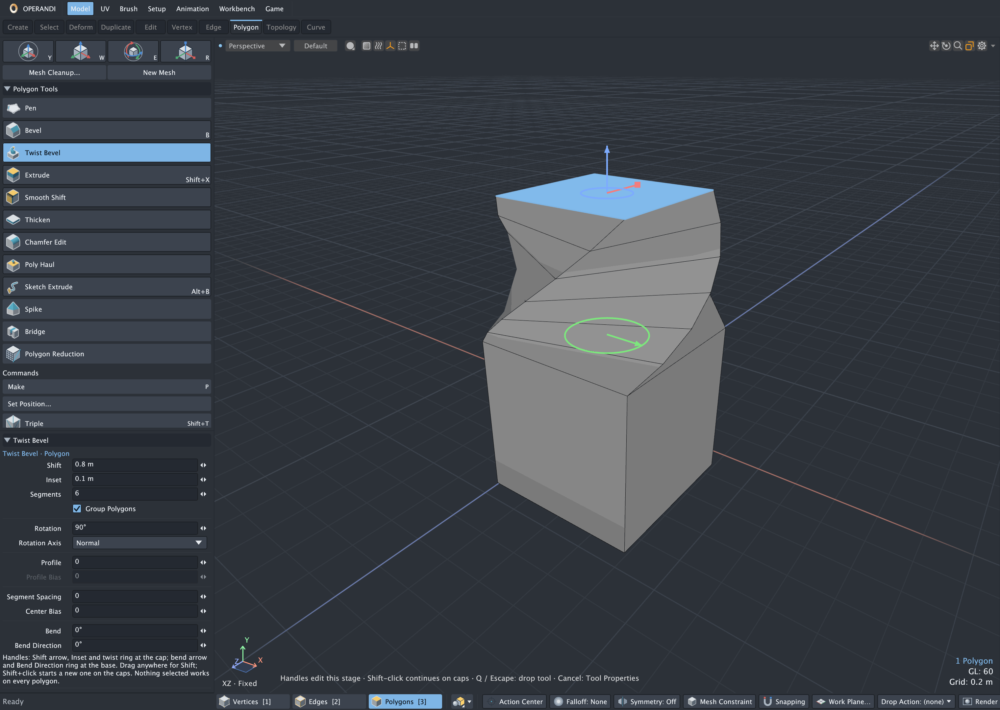

<!-- help-ids: Twist Bevel ; template: tool ; since: 0.1.0 -->
# Twist Bevel

**Twist Bevel** bevels polygons out into a tube that can taper, twist and bend along its length.

## How to use

1. Press **3** for Polygons and select the polygons.
2. Click **Twist Bevel** on the **Polygon** tool tab.
3. Drag anywhere for **Shift**, or use the handles: the **Shift** arrow, the
   **Inset** and twist ring at the cap, the bend arrow and bend direction ring
   at the base. **Shift**-click starts a new bevel on the caps.
4. Press **Q**, or click **Drop Tool**, to keep the result. **Cancel** takes it back.

With nothing selected, every polygon is bevelled.

## Properties

| Name | What it does |
|---|---|
| **Shift** | How far the tube reaches out. |
| **Inset** | How much the end of the tube shrinks. |
| **Segments** | How many rows along the tube. |
| **Group Polygons** | Bevels touching polygons together as one. |
| **Stop Before Fold** | When the cap would fold over itself, the **Inset** stops just short of that instead of the tube being refused. Off by default. |
| **Even Interior** | Points inside a grouped cap, and along its straight edges, move with the **Inset**, so the whole cap shrinks evenly instead of only its outline. Off by default. |
| **Keep Cap UVs** | The caps keep their UVs exactly, seams included; only the walls get new UVs. Off, the caps' UVs shrink with the **Inset**. Off by default. |
| **Rotation**, **Rotation Axis** | How far the tube twists along its length, and about which axis (**Normal** by default). |
| **Profile** | Shapes the tube's outline along its length. |
| **Segment Spacing**, **Center Bias** | Bunches the rows toward one end or the middle. |
| **Bend**, **Bend Direction** | Curves the tube, and which way. |

## Tips

- New points keep the weights, colours and morphs of the points they came
  from, so a morph still moves the tube with the rest of the mesh. The
  walls are the same type as the polygons they came from: SubD stays SubD.
- On a moved or rotated item the handles sit on the tube's cap, **Bend
  Direction** 0 points along world X and the **Action Axis** twist turns
  about the world axis.
- Angles show to a tenth of a degree while you drag a ring.

## Related

- [Polygon tab](index.md)
- [Selection modes](../selection/selection-modes.md)
- [Bevel](../modeling/polygon-bevel.md)
