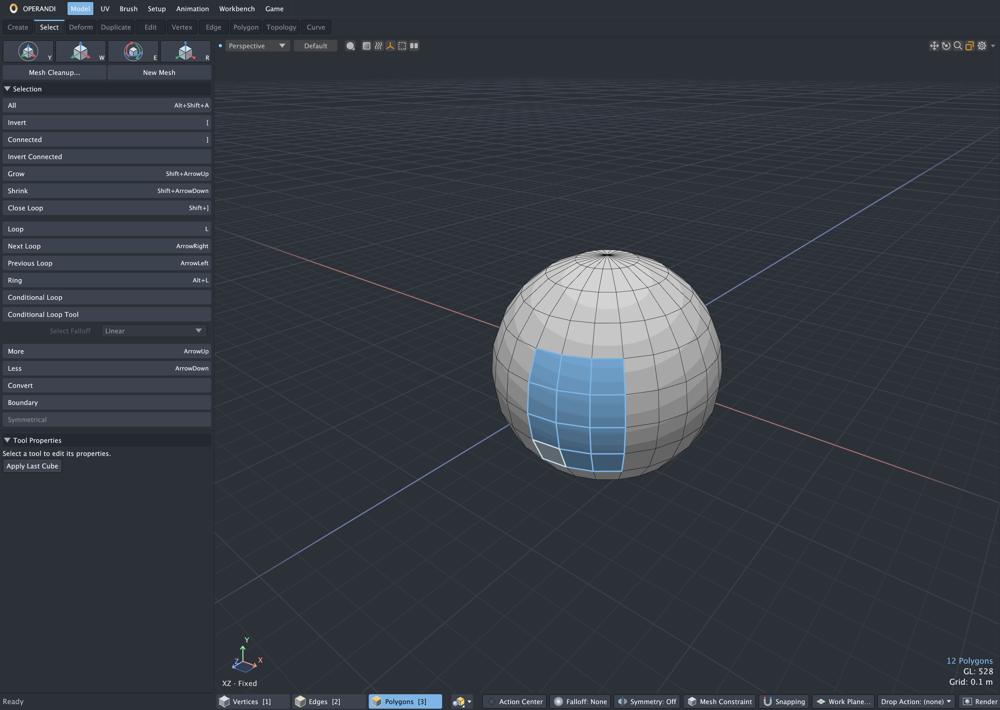
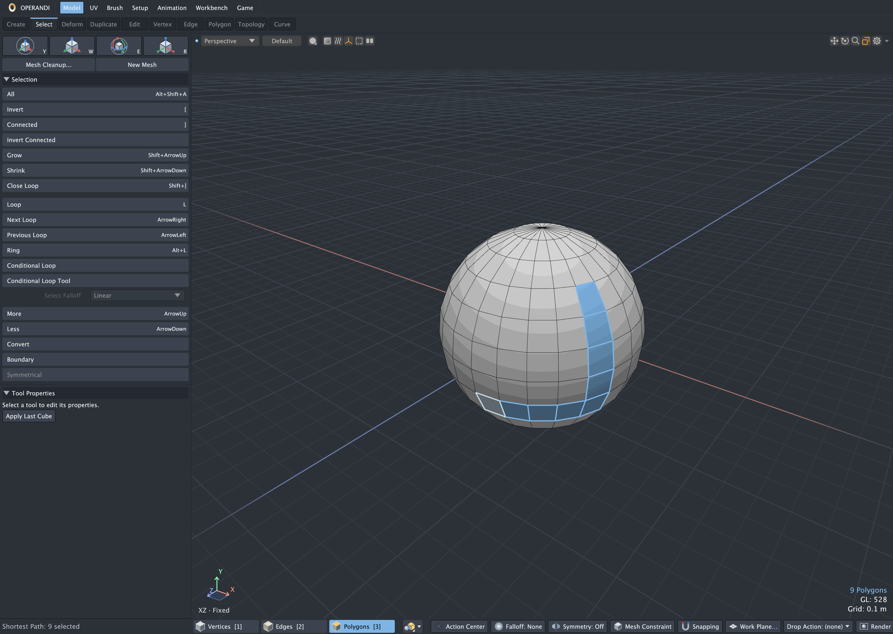

<!-- help-ids: Select Between, Shortest Path, Shortest Path Mode, select.between, select.shortestPath ; template: concept ; since: 0.1.0 -->
# Between and shortest path

Two ways to select the elements between two you picked: **Between** fills the rectangle they span, **Shortest Path** follows the shortest route from one to the other.

## Between

1. Click one polygon (or edge, or point), then **Shift**-click another.
2. Click **Between** on the **Select** tab, or press **Shift+G**.

With more than two picked, only the last two are joined.

## Shortest Path

1. Click a start, then **Shift**-click an end.
2. Click **Shortest Path** on the **Select** tab.

**Shortest Path Mode** (on the **Select** tab) makes it automatic: each
**Shift**-click then adds the element and the path to it.

## Related

- [Selection modes](selection-modes.md)
- [Select tab](select-tab.md)
