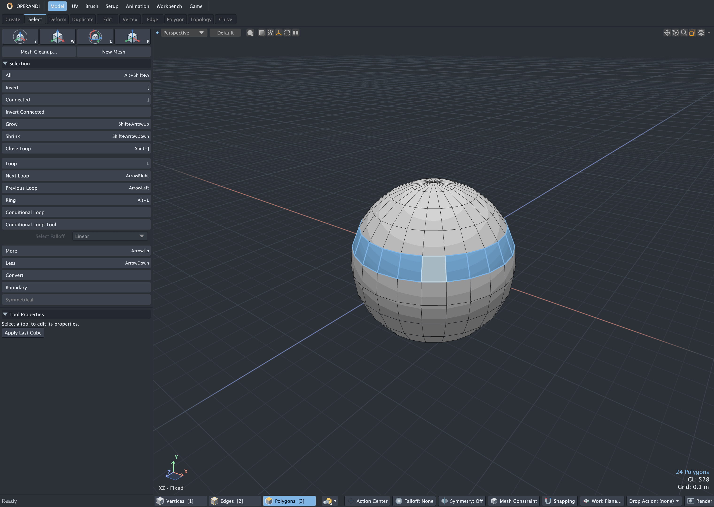

<!-- help-ids: Loop, Next Loop, Previous Loop, Ring, Close Loop, Conditional Loop, Conditional Loop Tool, select.loop, select.ring, select.closeLoop, select.conditionalLoop, seam.marker ; template: concept ; since: 0.1.0 -->
# Loops and rings

A loop is a line of edges or polygons that runs straight on across the mesh; a ring is the edges side by side across a strip of polygons.

## Commands

| Button | Key | What it does |
|---|---|---|
| **Loop** | **L** | From one edge, one polygon or two neighbouring points, selects the whole loop it lies in. |
| **Next Loop** | **Right Arrow** | Replaces the loop with the parallel loop beside it. |
| **Previous Loop** | **Left Arrow** | The parallel loop on the other side. |
| **Ring** | **Alt+L** | From one or more edges, selects the ring of edges across their strip. |
| **Close Loop** | **Shift+]** | From two neighbouring polygons, selects the loop they start. |
| **Conditional Loop** |  | Grows the last selected edge into a loop until a stop rule ends it. |
| **Conditional Loop Tool** |  | Opens the stop rules, then runs **Conditional Loop**. |

In Edge mode a double-click selects a loop too.

## Conditional Loop stop rules

| Name | What it does | Default |
|---|---|---|
| **Loop Both Directions** | Grows both ways from the edge. | On |
| **Max Loop** | Stops after this many edges; 0 has no limit. | 0 |
| **Stop at Shared Polygon** | Stops where the loop would cross a polygon it already uses. | On |
| **Stop at Sharp Angles** | Stops where the loop turns more than **Sharp Angle**. | On, 60° |
| **Stop at Length Difference** | Stops where the next edge's length differs by more than **Length Tolerance**. | Off, 3 |
| **Stop at Selection** | Stops at already selected edges, after **Selection Count** of them. | On, 2 |

## Related

- [Selection modes](selection-modes.md)
- [Select tab](select-tab.md)
