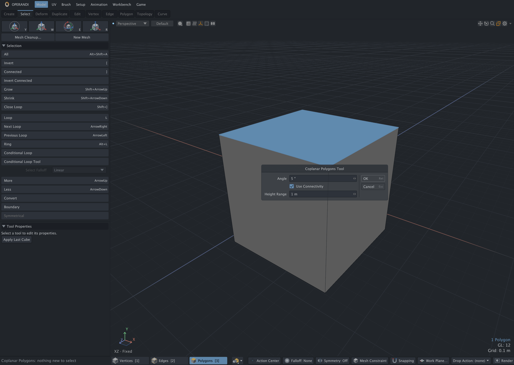

<!-- help-ids: Coplanar Polygons Tool, Coplanar Edges..., Colinear Vertices..., Diagonal..., Sharp..., select.polygonCoplanar, select.edgeCoplanar, select.vertexColinear, select.edgeDiagonal, select.edgeSharp ; template: concept ; since: 0.1.0 -->
# Select by shape

These commands select by the shape of the mesh: flat areas, straight rows of points, sharp edges and the diagonals of triangle pairs. Each opens a small dialog with its settings first.

## Commands

| Button | Selects | Settings (defaults) |
|---|---|---|
| **Coplanar Polygons Tool** | From the selected polygons, the neighbours that face the same way. | **Angle** 5°; **Use Connectivity** on (only polygons reached through others that qualify); **Height Range** 1 m (with Use Connectivity off: how far from the start polygon's plane) |
| **Coplanar Edges...** | Edges whose two polygons are flat with each other. | **Flatness** 0.005 |
| **Colinear Vertices...** | Points that lie on the line through their outline neighbours. | **Distance** 0.000001 m (how far off the line a point may sit) |
| **Diagonal...** | The edges that would join triangle pairs into quads. | **Flatness** 20%, **Max Angle** 170°; **Keep Material / Part / Smoothing Group / Selection Set Boundary** |
| **Sharp...** | Edges whose polygons meet at an angle between the two limits. | **Minimum Angle** 89.55°, **Maximum Angle** 180° |

## Related

- [Selection modes](selection-modes.md)
- [Select tab](select-tab.md)
