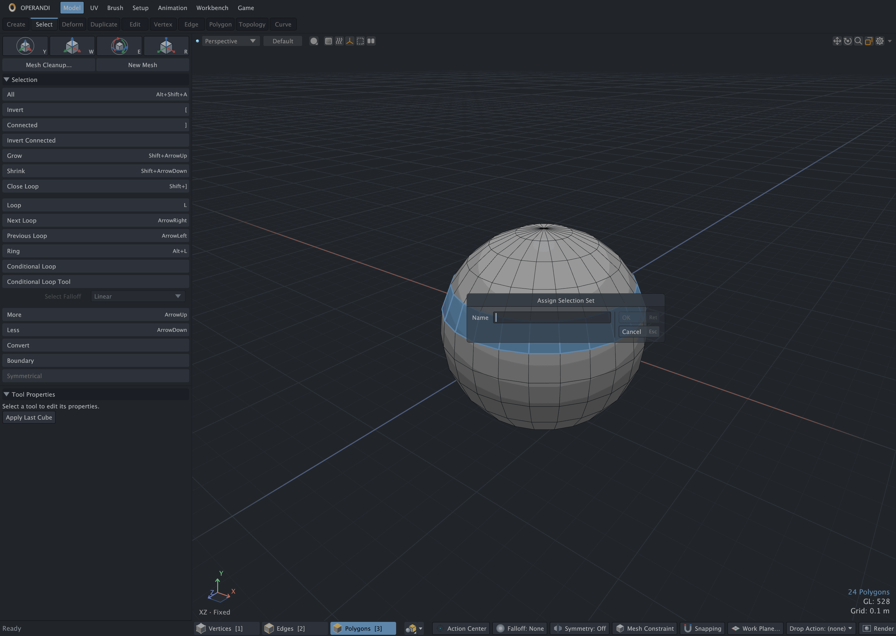

<!-- help-ids: select.editSet, select.useSet, select.deleteSet, select.convertGroup, selset.ungroup ; template: concept ; since: 0.1.0 -->
# Selection sets

A selection set saves a selection under a name, so you can get it back later. Each set belongs to one mode: points, edges or polygons.

## How to use

1. Select the points, edges or polygons.
2. Click **Assign Selection Set...** on the **Select** tab, type a **Name**
   and click **OK**. A set that already has that name gains the selection.
3. Later, click **Use Selection Set...**, pick the **Set**, and choose a
   **Mode**: **Replace** the selection, **Select** (add the set) or
   **Deselect** (remove it).

**Delete Selection Set...** deletes a set (or, with **All Sets**, every set
of the mode); the geometry itself is never deleted. **Create Selection Set
Group...** collects sets into a named group.

## Related

- [Selection modes](selection-modes.md)
- [Select tab](select-tab.md)
