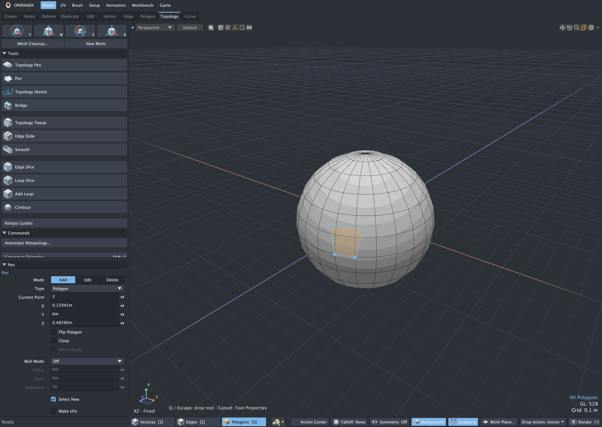

<!-- help-ids: operandi.topology.tool ; template: concept ; since: 0.1.0 -->
# Topology tab

The **Topology** tool tab is set up for *retopology*: building a clean,
light mesh over a detailed model, the *background* mesh. Each tool button
starts its tool with **Constrain to Background** on, so new points land
on the background's surface; your settings come back when you drop the
tool.

## How to use

1. Keep the detailed model visible but not selected: it is the background.
2. Click **New Mesh** (or select the mesh you are building) in the
   **Items list**.
3. Turn on **Topology Mode** in **Settings**, so your new mesh draws over
   the background, see-through.
4. Use the tools: their points stick to the background's surface.

## The tab

| Section | Buttons |
|---|---|
| **Tools** | [Topology Pen](../modeling/topology-pen.md), [Pen](../modeling/pen.md), Topology Sketch ([Sketch](../modeling/sketch.md)), [Bridge](../duplicate/bridge.md), Topology Tweak ([Element Move](../deform/element-move.md)), [Edge Slide](../edit/slide.md), [Smooth](../deform/smooth.md), [Edge Slice and Loop Slice](../edit/slice-tools.md), [Add Loop](../edge/add-loop.md), [Contour](contour.md), Retopo Guides ([Retopo Sketch](../edit/retopology.md)) |
| **Commands** | [Automatic Retopology](../edit/retopology.md), Convert to Triangles and Convert to Quadrangles ([Triple, Quadruple](../polygon/triangles.md)), [Grow Quads](../edge/quads.md), Subdivide ([SDS Subdivide](../edit/subdivide.md)), [Instance Mirror](../duplicate/mirror.md), [Merge Instance](settings.md) |
| **Settings** | Toggle Verts ([Show Vertices](../vertex/index-order.md)), [Topology Mode and Constrain to Background](settings.md) |
| **Modifiers** | Soft Selection (a [soft selection falloff](../deform/soft-selection.md)), [Lazy Select](../selection/select-tab.md) |

## Related

- [Selection modes](../selection/selection-modes.md)
