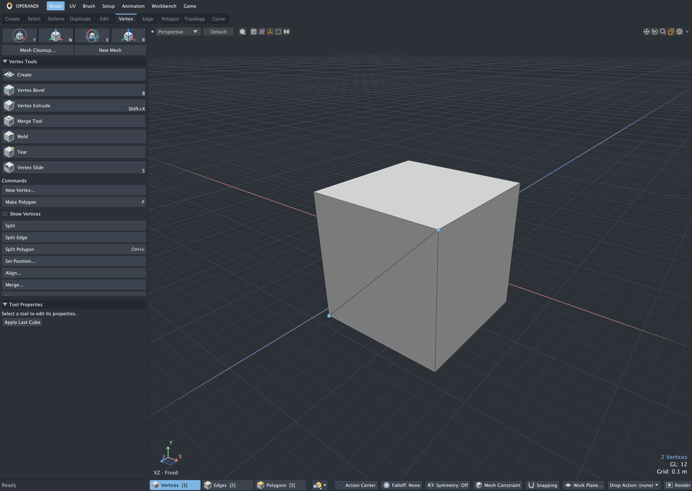

<!-- help-ids: Make, poly.make, Vertex Split, vert.split, Vertex Split Edge, vert.splitEdge, Split, poly.split ; template: tool ; since: 0.1.0 -->
# Make Polygon and Split

Commands that build polygons from points, or cut points and polygons apart.

## The commands

| Button | Key | What it does |
|---|---|---|
| **Make Polygon** | **P** | Makes a polygon from the selected points, or a quad from two border edges. |
| **Split** |  | Gives each polygon at the selected points its own copy of the point, so the polygons come apart there. |
| **Split Edge** |  | Splits the selected points along edges. |
| **Split Polygon** | **Control+L** | Connects pairs of selected points on the same polygon with a new edge. |

## Related

- [Vertex tab](index.md)
- [Selection modes](../selection/selection-modes.md)
