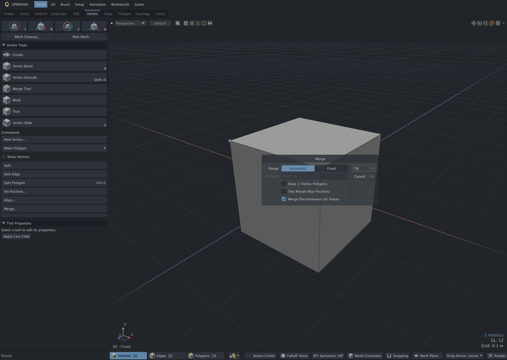

<!-- help-ids: Merge Tool, Weld, DragWeld, Vertex Merge, Vertex Join, Vertex Join Averaged, vert.merge, vert.join ; template: tool ; since: 0.1.0 -->
# Merge, Join and Weld

Four ways to turn several points into one.

## The tools

| Button | What it does |
|---|---|
| **Merge Tool** | Merges selected points that lie within **Distance** of each other, at their average. Nothing stays selected. |
| **Weld** | Drag a point onto another to merge them there; release elsewhere to just move it. Click **Drop Weld** (**Q**) to stop. |
| **Merge...** | The same as Merge Tool, from a dialog. |
| **Join...** | Joins all the selected points into one, at the last selected point. |
| **Join Averaged** | Joins all the selected points into one, at their average position. |

## Merge options

| Name | What it does | Default |
|---|---|---|
| **Range** | **Automatic** merges points that sit on each other; **Fixed** uses **Distance**. | Automatic |
| **Distance** | Points closer than this merge. | 0.001 m |
| **Keep 1-Vertex Polygons** | Polygons squashed to two corners stay as lines. | Off |
| **Test Morph Map Positions** | Points must also be within **Distance** in every morph map. | Off |
| **Merge Discontinuous UV Values** | Where merged corners now have the same UV, they share it. | On |

**Join...** has **Keep 1-Vertex Polygons** and **Join Discontinuous UVs**.

## Related

- [Vertex tab](index.md)
- [Selection modes](../selection/selection-modes.md)
- [Remove and Collapse](remove-collapse.md)
