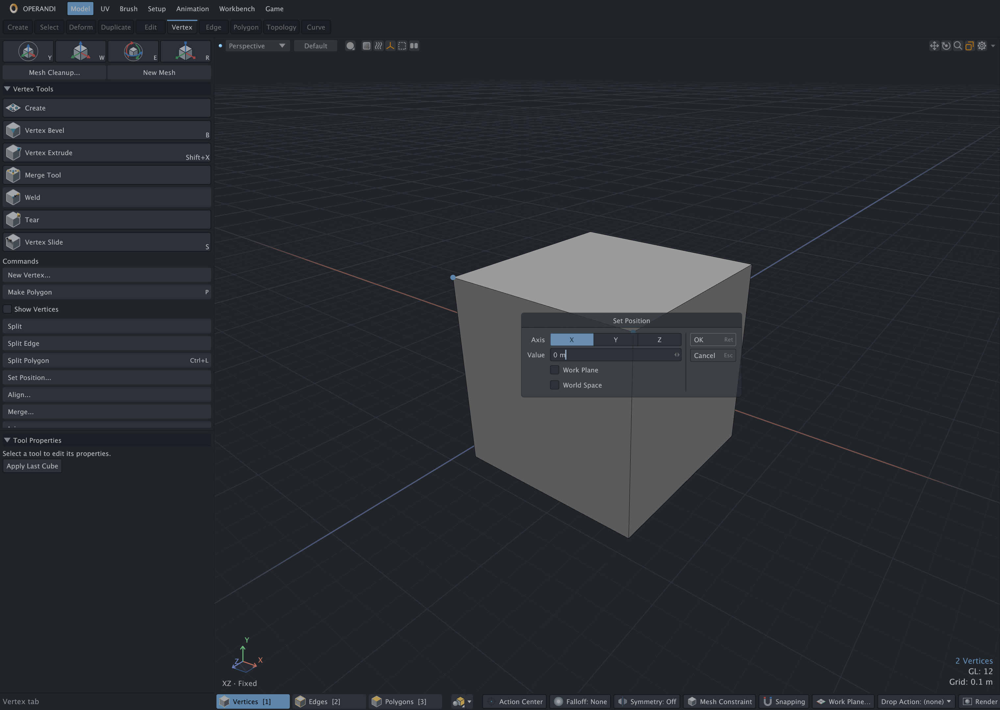

<!-- help-ids: New Vertex, vert.new, Vertex Set Position, vert.set, Vertex Align, vert.align ; template: tool ; since: 0.1.0 -->
# Place points exactly

Three dialogs place points at exact positions.

## The commands

| Button | What it does |
|---|---|
| **New Vertex...** | Adds one point at the **X**, **Y** and **Z** you type. |
| **Set Position...** | Sets one coordinate (**Axis** X, Y or Z) of every selected point to **Value**. **Work Plane** measures it on the work plane; **World Space** makes it a world coordinate. |
| **Align...** | Lines the selected points up on a line along the chosen **Axis** (or all). **Uniform** also spaces them evenly. |

## Related

- [Vertex tab](index.md)
- [Selection modes](../selection/selection-modes.md)
