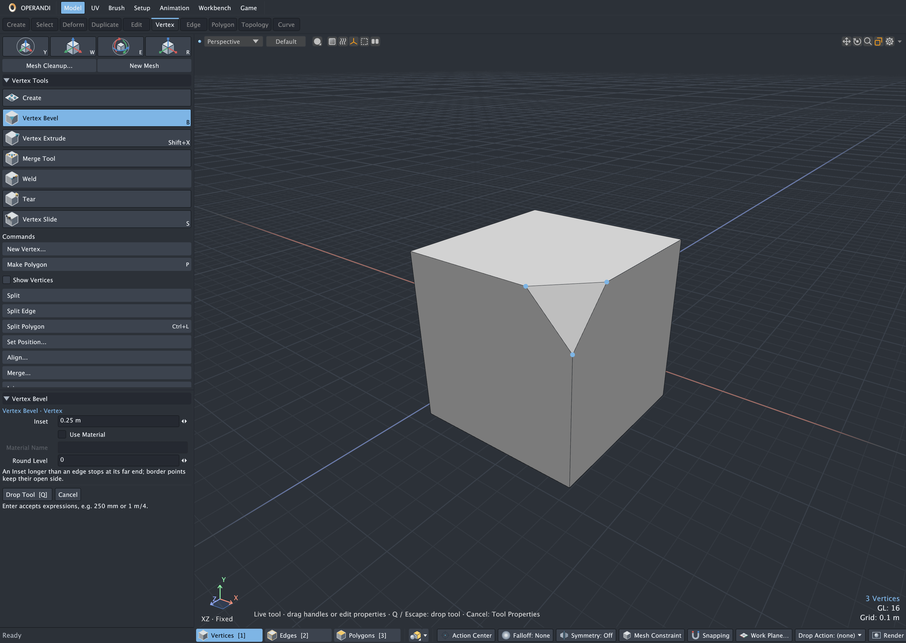

<!-- help-ids: Vertex Bevel ; template: tool ; since: 0.1.0 -->
# Vertex Bevel

**Vertex Bevel** cuts the selected points off: each corner becomes a small new polygon, its sides set back by **Inset** along the edges.

## How to use

1. Press **1** for Vertices and select the points.
2. Press **B**, or click **Vertex Bevel**.
3. Drag in the view, or type **Inset**.
4. Press **Q**, or click **Drop Tool**, to keep the result. **Cancel** takes it back.

## Properties

| Name | What it does | Default |
|---|---|---|
| **Inset** | How far along each edge the cut is made. An inset longer than an edge stops at its far end. | 0 m |
| **Use Material**, **Material Name** | Gives the new polygon a material of its own. | Off |
| **Round Level** | Rounds each side of the cap into 2 × Round Level segments, 0 to 32. | 0 |

Border points keep their open side.

## Related

- [Vertex tab](index.md)
- [Selection modes](../selection/selection-modes.md)
- [Bevel (polygons)](../modeling/polygon-bevel.md)
