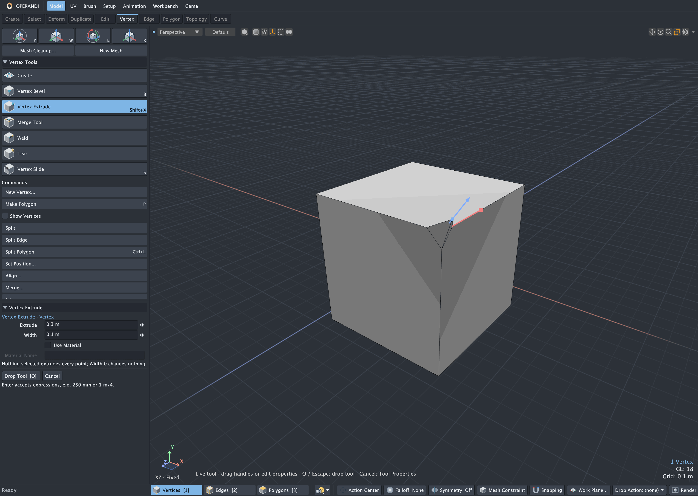

<!-- help-ids: Vertex Extrude ; template: tool ; since: 0.1.0 -->
# Vertex Extrude

**Vertex Extrude** pulls the selected points out into spikes: each one is bevelled by **Width** and the new cap pushed out by **Extrude**.

## How to use

1. Press **1** for Vertices and select the points.
2. Press **Shift+X**, or click **Vertex Extrude**.
3. Drag in the view, or type **Extrude** and **Width**.
4. Press **Q**, or click **Drop Tool**, to keep the result. **Cancel** takes it back.

## Properties

| Name | What it does | Default |
|---|---|---|
| **Extrude** | How far the new point moves out. | 0 m |
| **Width** | How wide the base of the spike is. 0 changes nothing. | 0.1 m |
| **Use Material**, **Material Name** | Gives the new polygons a material of their own. | Off |

With nothing selected, every point is extruded.

## Related

- [Vertex tab](index.md)
- [Selection modes](../selection/selection-modes.md)
- [Vertex Bevel](vertex-bevel.md)
